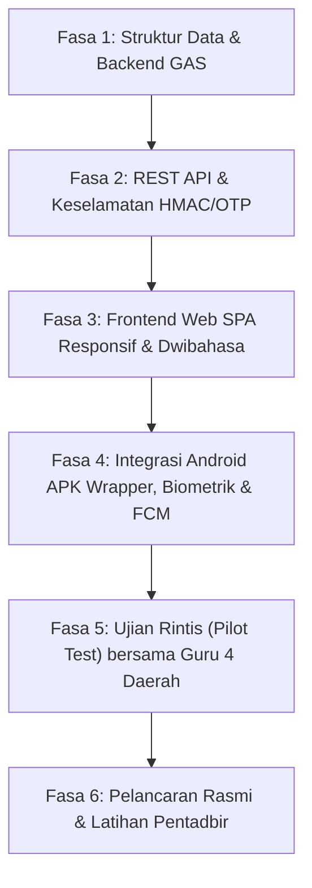

# DOKUMEN KEPERLUAN PRODUK (PRD)
## PORTAL CEU (CAREER EDUCATION UNIT)
### Unit Pendidikan Kerjaya, Jabatan Sekolah-Sekolah, Kementerian Pendidikan Brunei Darussalam

---

## 1. Ringkasan Eksekutif (Executive Summary)
**Portal CEU (Career Education Unit)** merupakan portal rasmi berasaskan aplikasi web Google Apps Script (GAS) dan Google Sheets yang dibungkus (*wrapped*) ke dalam format **APK Android (dan sokongan iOS)** untuk kemudahan capaian mudah alih para Guru Pendidikan Kerjaya serta Pegawai Unit Pendidikan Kerjaya (UPK) di seluruh 4 daerah Negara Brunei Darussalam (Brunei-Muara, Tutong, Belait, dan Temburong).

Sistem ini memusatkan pengurusan takwim, arkib memo rasmi, minit mesyuarat, hebahan notifikasi (emel, papan pemuka, dan notifikasi tolak FCM Android), serta pengesanan RSVP kehadiran secara automatik. Portal ini menguatkuasakan log masuk emel rasmi kerajaan Brunei (`.moe.bn`, `.gov.bn`, `.edu.bn`) dengan sokongan log masuk pantas biometrik (Cap Jari / Face ID) melalui penyulitan *Android Keystore* berasaskan token HMAC 30 hari. Antaramuka aplikasi dibina secara *mobile-first responsive*, dwibahasa (Bahasa Melayu Standard Brunei & Bahasa Inggeris), dan mengguna pakai identiti warna rasmi lencana UPK.

---

## 2. Matlamat Produk & Nilai Strategik (Product Goals & Business Value)
1. **Pemusatan Maklumat Rasmi:** Menghentikan penyebaran dokumen dan takwim yang berselerak melalui WhatsApp dan emel peribadi. Semua minit mesyuarat, memo pekeliling, dan takwim tahunan disimpan dalam arkib digital berstruktur.
2. **Pengurusan RSVP Acara Masa Nyata:** Menghapuskan keperluan memungut kehadiran secara manual. Pegawai pentadbir boleh menjejaki status kehadiran 4 daerah secara langsung dan menjana laporan rasmi berformat PDF sekali klik.
3. **Penyampaian Notifikasi Terjamin:** Menyampaikan hebahan penting secara serentak melalui emel rasmi, *In-App Bulletin Board*, dan *Push Notification* FCM peranti Android.
4. **Log Masuk Pantas & Selamat (Biometrik):** Mengurangkan kebergantungan terhadap OTP berulang dengan mengaktifkan pengesahan cap jari/Face ID pada peranti mudah alih tanpa mengorbankan keselamatan pangkalan data.
5. **Kebolehcapaian Dwibahasa:** Menyokong Bahasa Melayu Standard Brunei dan Bahasa Inggeris dengan suis tukar (*language toggle*) 1-klik.

---

## 3. Profil Pengguna & Matriks Capaian (Role-Based Access Control / RBAC)

| Peranan (*Role*) | Sasaran Pengguna | Peranti Utama | Hak Capaian & Tanggungjawab |
| :--- | :--- | :--- | :--- |
| **Admin** *(Pegawai Unit Pendidikan Kerjaya)* | Pegawai UPK, Jabatan Sekolah-Sekolah | Komputer / Telefon Pintar | • Pengurusan penuh program & acara kerjaya. • Memuat naik memo, minit mesyuarat, & takwim tahunan. • Pengesahan & kelulusan pendaftaran guru baharu. • Pemantauan status RSVP (Hadir/Wakil/Tidak Hadir/Belum Respon). • Muat turun laporan PDF kehadiran rasmi ber-QR. • Menghantar hebahan emel & FCM broadcast. • Pengurusan sesi & pembatalan token peranti (*device revocation*). |
| **Guru** *(Guru Pendidikan Kerjaya)* | ~37+ Guru Pendidikan Kerjaya di 4 Daerah (Kluster Menengah & Pusat Tingkatan Enam) | Telefon Pintar (Aplikasi APK) | • Log masuk emel rasmi MOE (`.moe.bn`, dll.) + OTP / Biometrik. • Melihat takwim dan maklumat program terperinci. • Mengisi respons RSVP (Hadir / Menamakan Wakil / Alasan Tidak Hadir). • Membaca dan memuat turun arkib memo & minit mesyuarat (view-only). • Menerima notifikasi tolak dan arkib buletin pengumuman. • Mengurus tetapan profil & pilihan pengesahan biometrik. |

---

## 4. Seni Bina Data & Integrasi Ekosistem Google Workspace

### 4.1 Struktur Pangkalan Data (Google Sheets)
* **`tbl_users`**:
  * `email` (PK, emel domain `.moe.bn` / `.gov.bn` / `.edu.bn`)
  * `full_name`, `ic_number` (pilihan)
  * `school_name`, `district` (*Brunei-Muara, Tutong, Belait, Temburong*)
  * `phone_number`, `role` (*Admin / Guru*)
  * `account_status` (*Active / Pending / Inactive*)
  * `fcm_device_token`, `biometric_enabled` (*TRUE/FALSE*), `created_at`
* **`tbl_events`**:
  * `event_id` (PK, cth: `EVT-2026-001`)
  * `title_bm`, `title_en`
  * `event_date`, `start_time`, `end_time`
  * `venue`, `meeting_link` (Google Meet / fizikal)
  * `rsvp_deadline`, `attachment_drive_url`
  * `status` (*Draft / Published / Completed / Cancelled*)
  * `created_by`, `created_at`
* **`tbl_rsvp`**:
  * `rsvp_id` (PK, cth: `RSVP-EVT001-USR01`)
  * `event_id` (FK), `user_email` (FK)
  * `response_status` (*Attending / Representative / Absent / Pending*)
  * `rep_name`, `rep_email`, `rep_phone` (diisi jika mewakilkan)
  * `absence_reason` (diisi jika tidak hadir)
  * `submitted_at`, `updated_at`
* **`tbl_memos_docs`**:
  * `doc_id` (PK), `title_bm`, `title_en`
  * `category` (*Memo Rasmi / Minit Mesyuarat / Dokumen Tahunan / Takwim*)
  * `drive_file_id`, `file_view_url`, `publish_date`
  * `target_audience` (*Semua / Daerah Tertentu*)
* **`tbl_notifications`**:
  * `notif_id` (PK), `title_bm`, `title_en`, `content_bm`, `content_en`
  * `type` (*Urgent / General / Event Update*)
  * `sent_at`, `sent_by`, `fcm_status`
* **`tbl_sessions_audit`**:
  * `session_id`, `user_email`, `device_fingerprint`, `token_hash`, `issued_at`, `expires_at`, `is_revoked`

### 4.2 Integrasi Google Drive
* Folder root induk: `CEU_PORTAL_SYSTEM/`
  * Sub-folder: `01_Takwim_dan_Acara/`
  * Sub-folder: `02_Minit_Mesyuarat/`
  * Sub-folder: `03_Memo_dan_Pekeliling/`
  * Sub-folder: `04_Laporan_Kehadiran_PDF/`
* Kawalan akses fail Drive: Hanya disetkan sebagai *View Only* bagi akaun guru dengan penyingkiran pautan muat turun awam terus.

### 4.3 Integrasi Emel (Gmail / MailApp) & Dokumen (Docs/Sheets)
* **Penghantaran OTP:** Melalui perkhidmatan `MailApp.sendEmail` dengan templat HTML rasmi UPK.
* **Penjanaan PDF:** Laporan RSVP diproses menggunakan templat Google Docs berjadual, ditukar kepada PDF secara automatik (*Blob*), dan disimpan dalam Drive sebelum dipaparkan kepada Admin.

---

## 5. Keperluan Fungsian (Functional Requirements)

### 5.1 Alur Log Masuk Dwi-Lapisan (OTP & Biometrik APK)
1. **Log Masuk Pertama (Pengesahan Identiti):**
   * Pengguna memasukkan emel rasmi (.moe.bn / .gov.bn / .edu.bn).
   * Sistem menyemak padanan di `tbl_users`. Jika sah, sistem menjana kod OTP 6 digit ber-salt (tempoh sah 10 minit) dan dihantar ke emel pengguna.
   * Selepas OTP berjaya disahkan, pelayan GAS menjana token HMAC 30 hari (`ceu_tok`).
2. **Pendaftaran Biometrik (Aplikasi APK):**
   * Selepas log masuk OTP pertama, dialog aplikasi memaparkan: *"Aktifkan log masuk biometrik untuk peranti ini?"*
   * Jika pengguna bersetuju, jambatan Android Native (`CEUAndroid.registerBiometric(token)`) menyimpan `ceu_tok` ke dalam **Android Keystore** (dienkripsi perkakasan TEE/SE).
   * Token dihapuskan daripada `localStorage` pelayar biasa untuk keselamatan maksimum.
3. **Pelancaran Aplikasi Seterusnya:**
   * Aplikasi memeriksa kehadiran token dalam Keystore.
   * `BiometricPrompt` Android muncul (Imbas Cap Jari / Pengecaman Wajah).
   * Jika disahkan: Token dibekalkan terus ke sesi memori aplikasi, dan papan pemuka terbuka sepantas < 1 saat tanpa menunggu emel OTP.
   * Jika gagal/batal: Pengguna diberi pilihan kembali ke log masuk OTP manual.
4. **Pembatalan Sesi & Peranti (Device Revocation):**
   * Sekiranya peranti guru hilang, Admin boleh membatalkan (*Revoke*) sesi peranti tersebut daripada papan pemuka Admin di `tbl_sessions_audit`.

### 5.2 Modul Pengurusan Acara & RSVP Pintar
* Admin menerbitkan acara baharu dengan tarikh luput RSVP.
* Guru menerima notifikasi dan melihat kad program di halaman utama.
* Guru memilih salah satu status RSVP:
  * **Hadir**: Pengesahan kehadiran guru.
  * **Mewakilkan**: Wajib mengisi nama guru pengganti dan nombor telefon.
  * **Tidak Hadir**: Wajib menyatakan ulasan/sebab ketidakhadiran rasmi.
* Paparan ringkasan masa nyata: Jumlah Respon, Hadir, Wakil, Tidak Hadir, Belum Jawab.

### 5.3 Modul Arkib Dokumen Digital
* Kategori teratur: Memo Rasmi, Minit Mesyuarat, Takwim Tahunan, Borang/Garis Panduan.
* Bar carian pantas mengikut kata kunci, tahun, dan kategori.
* Pemapar dokumen terbenam (*Embedded PDF Viewer*) dalam aplikasi mudah alih.

### 5.4 Modul Laporan Kehadiran Rasmi
* Penapis laporan mengikut Acara, Tarikh, dan Daerah (*Brunei-Muara, Tutong, Belait, Temburong*).
* Paparan graf visual (Carta Pai & Bar) pecahan status RSVP.
* Butang **"Jana PDF Kehadiran Rasmi"** lengkap dengan format kepala surat (*letterhead*) UPK, cap masa laporan, dan kod QR verifikasi dokumen.

### 5.5 Enjin Dwi-Bahasa (BM & EN)
* Butang togol bahasa `BM | EN` pada bar navigasi atas.
* **Bahasa Melayu Standard Brunei:** Menggunakan istilah rasmi tempatan (cth: *Unit Pendidikan Kerjaya, Jabatan Sekolah-Sekolah, Daerah, Kehadiran, Tarikh Tutup, Minit Mesyuarat*).
* **Bahasa Inggeris:** (cth: *Career Education Unit, Department of Schools, District, Attendance, RSVP Deadline, Meeting Minutes*).

---

## 6. Kekangan Teknikal & Mitigasi Kuota Google Apps Script

| Kekangan GAS | Risiko | Strategi Mitigasi / Penyelesaian |
| :--- | :--- | :--- |
| **Had Masa Eksekusi (6 Minit)** | Pemprosesan laporan PDF atau broadcast emel terhenti | Pemprosesan data RSVP dioptimumkan secara *in-memory array processing* dan operasi baca lembaran kerja secara *Batch Read* (`getValues()`) sekali panggil. |
| **Had Kuota Emel Harian (100-1500 emel/hari)** | Kehabisan kuota semasa menghantar OTP atau makluman | Notifikasi harian diutamakan melalui papan buletin aplikasi dan FCM Push Notification. Emel difokuskan khusus untuk OTP dan pengumuman kritikal sahaja. |
| **Latensi Tindak Balas Google Sheets** | Aplikasi perlahan semasa dibuka pada telefon pintar | Menggunakan `CacheService` pelayan GAS (caching JSON 15-30 minit untuk data takwim dan memo). Aplikasi terasa serta-merta tanpa membaca helaian setiap detik. |
| **Keselamatan Token & Sesi** | Pencerobohan sesi pengguna | Token disulitkan menggunakan HMAC-SHA256 ber-kunci rahsia (*Script Properties*). Sesi biometrik disimpan dalam Android Keystore, bukan *plaintext localStorage*. |

---

## 7. Spesifikasi Antaramuka & Reka Bentuk (UI/UX)

### 7.1 Palet Warna Rasmi (Berasaskan Logo UPK)
* **Warna Utama (Primary Blue):** `#1883B5` *(Biru Cerulean teras logo)*.
* **Warna Sekunder (Deep Navy/Cyan):** `#0E5677` *(Biru pekat untuk bar navigasi dan pengepala)*.
* **Warna Penegasan / Aksen Emas (Accent Gold):** `#C59A27` *(Warna huruf 'UPK' klasik logo untuk lencana, butang tindakan utama, dan sorotan)*.
* **Warna Sempadan Lembut (Soft Border):** `#89C4F4` *(Biru muda lingkaran luar logo untuk garis pembahagi dan kad status)*.
* **Warna Peringatan (Coral/Alert Red):** `#D32F2F` *(Warna garis pemisah logo untuk status amaran atau belum bertindak)*.
* **Latar Belakang (Neutral Background):** `#F4F7FA` *(Kelabu cerah bersih yang menjimatkan mata pada skrin mudah alih)*.

### 7.2 Susun Atur Mudah Alih (Mobile-First Layout)
* **Pengepala Aplikasi (App Header):** Logo UPK bulat di sebelah kiri, nama ringkas sistem, butang togol dwi-bahasa (BM/EN), dan butang profil/keluar.
* **Bar Navigasi Bawah (Bottom Navigation Bar):**
  1. 🏠 **Utama (Home/Takwim)**
  2. 📋 **RSVP (Acara & Status)**
  3. 📁 **Arkib (Memo & Minit)**
  4. 🔔 **Notifikasi (Hebahan)**
  5. ⚙️ **Pentadbir (Admin - hanya kelihatan untuk pegawai UPK)**
* **Komponen Kad Responsif:** Kad bersudut bulat (*rounded cards* 16px) dengan bayang lembut, dioptimumkan untuk sentuhan ibu jari.
* **Penunjuk Status Jelas:** Lencana berwarna (Hijau: Hadir, Kuning Emas: Wakil, Merah: Tidak Hadir, Kelabu: Belum Respon).

---

## 8. Pelan Pelaksanaan & Tahapan Pengujian

1. **Ujian Unit Backend:** Pengesahan kebolehpercayaan API OTP emel domain rasmi Brunei dan penjanaan token HMAC.
2. **Ujian Biometrik APK:** Memastikan token disimpan rapi dalam Keystore dan tidak bocor walaupun peranti dimatikan semula.
3. **Ujian Penjanaan PDF & RSVP:** Ujian beban simulasi 50 guru menghantar jawapan RSVP serentak dan pengesahan kualiti PDF laporan.
4. **Ujian Ketahanan Luar Talian (Offline Graceful Degradation):** Paparan cache arkib memo sedia ada apabila sambungan internet sekolah terputus seketika.

---

---
🎨 **Tahapan Khusus: Penentuan Visual UI/UX**
1. Unggah Referensi: Silakan unggah referensi tangkapan layar, warna, dan gaya antarmuka yang diinginkan.
2. Jika Belum Ada Referensi Visual:
   - Salin seluruh teks dokumen PRD Final di atas.
   - Buka Google Stitch, lalu tempelkan teks PRD ke dalamnya.
   - Unduh hasil pratinjau desain visual yang dihasilkan oleh Google Stitch.
   - Unggah gambar hasil desain tersebut ke percakapan ini untuk diimplementasikan ke dalam kode HTML/CSS.
